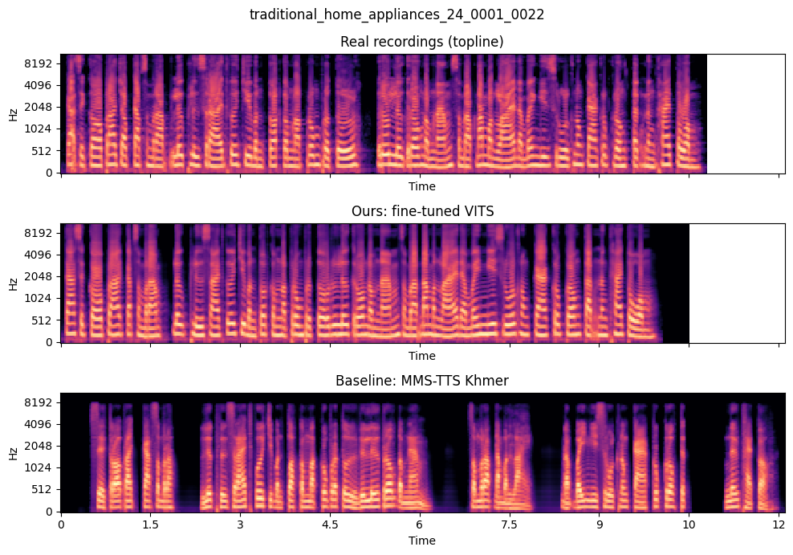
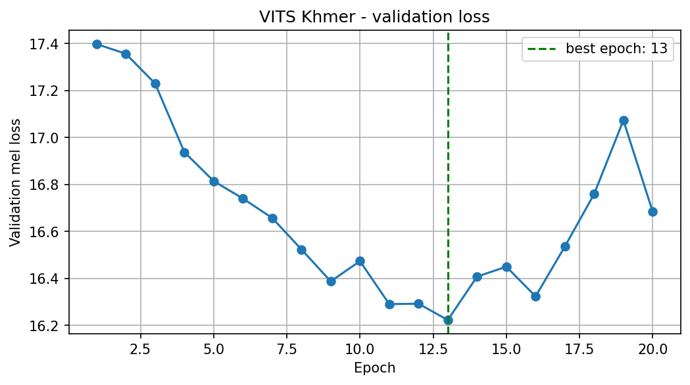

# Khmer Text-to-Speech (VITS)

**ITM 454 Natural Language Processing · Fall 2026 · American University of Phnom Penh**
**Group 5:** AN Sovannchakriya · CHAN Natalie · KUYSENG Chesda · LY Mengchou
**Instructor:** Monyrath Buntoun

We built a system that reads Khmer text out loud. We took a pretrained **VITS** speech model and fine-tuned it on about 20 hours of recordings from one native Khmer speaker. Then we compared it with real recordings and with Meta's public **MMS-TTS Khmer** model.

---

## Results

| | Error rate (CER) ↓ | Error rate on new sentences ↓ | Sound difference from real voice (MCD) ↓ |
|---|---|---|---|
| Real recordings | 0.7% | – | – |
| **Our model** | **6.7%** | **9.8%** | **4.90 dB** |
| MMS-TTS Khmer | 20.2% | 24.3% | 7.30 dB |

**CER** = how many characters a speech-recognition model gets wrong when it listens to the audio (lower is better).

- Our model makes about **3× fewer errors** than MMS-TTS Khmer.
- **74%** of test sentences are near-perfect. Only 12 of 399 have clear mistakes.
- It speaks at the speaker's natural pace.
- The hardest character is the repeat mark **ៗ**: the model often doesn't repeat the word.

---

## Graphs

**Error rate by system:** our model vs MMS-TTS Khmer vs real recordings.
<p align="center"></p>

**Error rate by topic:** Recipes is the hardest, Etiquettes the easiest.
<p align="center"></p>

**Error rate by sentence length:** short sentences are slightly harder.
<p align="center"></p>

**Sound difference (MCD) and speaking speed:** our model is closer to the real voice and speaks at a natural pace.
<p align="center"></p>

**Spectrograms:** the same sentence spoken by the real speaker, our model and MMS.
<p align="center"></p>

**Training loss:** validation loss for each epoch. The best model was at epoch 13.
<p align="center"></p>

---

## Folder structure

```
nlp-tts/
├── notebooks/
│   ├── 1_text_preprocessing.ipynb   Step 1: clean the Khmer text
│   ├── 2_audio_preprocessing.ipynb  Step 2: check and prepare the audio
│   ├── 3_vits_training.ipynb        Step 3: train the model
│   └── 4_evaluation.ipynb           Step 4: test the model
├── training/    training summary and loss curve
├── results/     all result tables (CSV)
├── figures/     charts
└── docs/        project proposal and progress report
```

The dataset, audio files and trained model are too large for GitHub. They are kept on Google Drive in `NLPfinalproject/`.

---

## How it works

1. **Text:** use one speaker (`f-adt2-0002`), clean the Khmer text and remove bad sentences → 10,621 sentences.
2. **Audio:** remove noisy or broken clips, convert to 22 kHz and split into train / validation / test → 9,616 / 395 / 399 clips.
3. **Training:** fine-tune VITS (Coqui TTS) from the English LJSpeech model on a Colab T4 GPU. The best result came at epoch 13.
4. **Evaluation:** generate speech for the test sentences, then measure:
   - **CER**, using a Khmer speech-recognition model
   - **MCD**, which compares the sound with the real recordings
   - **speed**
   - **errors**, sorted by topic, sentence length and character

   The notebook also prepares a listening test (MOS).

**Dataset:** Khmer ASR Cultural Dataset V2 by Digital Divide Data (CC BY-SA 4.0).

---

## How to run

1. In Google Drive, add a shortcut to the `NLPfinalproject` folder in **My Drive**.
2. Open the notebooks in order in Google Colab.
3. For Steps 3 and 4, choose **Runtime → Change runtime type → T4 GPU**, then **Runtime → Run all**.

---

## Still to do

- **Listening test (MOS):** native Khmer speakers rate the audio from 1 to 5. The clips are ready; the ratings aren't collected yet.
- **Train longer:** the model trained for only about 15,000 steps. Training longer should make it better.
- **Fix ៗ:** write the repeated word out in full before training.

## Limitations

- One speaker, and mostly cultural topics.
- CER depends on one speech-recognition model, so listener ratings (MOS) are still needed.
- The new-sentence test has only 10 sentences.

## References

- Kim et al. (2021). *VITS: Conditional Variational Autoencoder with Adversarial Learning for End-to-End Text-to-Speech.* ICML.
- Coqui TTS (2021). doi:10.5281/zenodo.6334862
- Digital Divide Data (2024). *Khmer ASR Cultural Dataset.*
- Pratap et al. (2023). *Scaling Speech Technology to 1,000+ Languages (MMS).* Meta AI.
- Seanghay (2026). *Qwen3-ASR-0.6B-Khmer.* Hugging Face.
