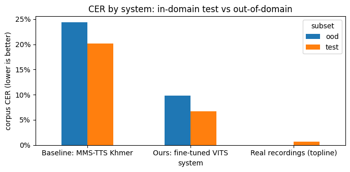
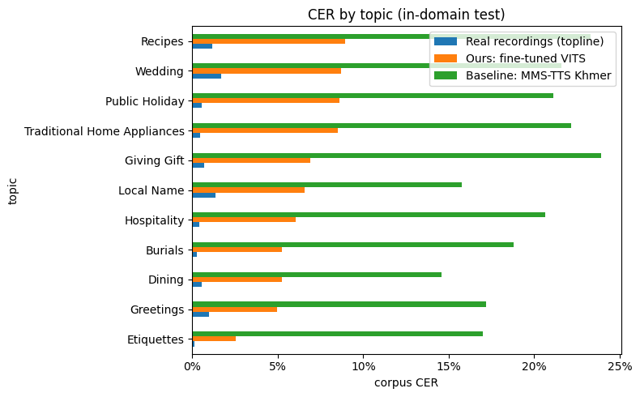
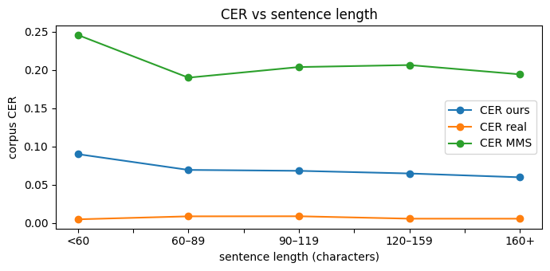
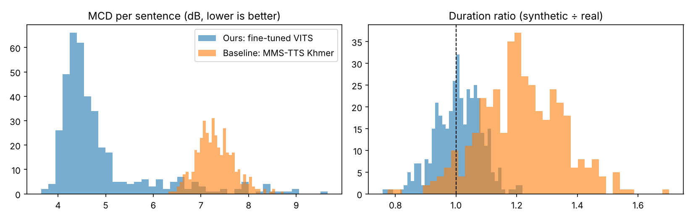

# Khmer Text-to-Speech with VITS

**ITM 454 Natural Language Processing, Fall 2026, American University of Phnom Penh**
**Group 5:** AN Sovannchakriya · CHAN Natalie · KUYSENG Chesda · LY Mengchou
**Instructor:** Monyrath Buntoun

This project builds a Khmer text-to-speech (TTS) system. It fine-tunes a pretrained **VITS** model on about 18 hours of one native Khmer speaker. Then it evaluates the model against the real recordings and against a public Khmer TTS baseline (Meta **MMS-TTS Khmer**), using an automatic metric (**CER**), an acoustic metric (**MCD**) and a listening test (**MOS**).

---

## Results at a glance

Evaluated on **399 unseen test sentences** (in-domain) and **10 everyday sentences** (out-of-domain). The model is the Step 3 checkpoint `best_model.pth` (best epoch 13).

| System | CER test ↓ | CER out-of-domain ↓ | MCD (dB) ↓ | Duration ratio | RTF ↓ (T4) |
|---|---|---|---|---|---|
| Real recordings (topline) | 0.7% | – | – | – | – |
| **Ours: fine-tuned VITS** | **6.7%** (95% CI 6.2–7.3) | **9.8%** | **4.90** | **1.01** | 0.036 |
| Baseline: MMS-TTS Khmer | 20.2% (95% CI 19.4–21.2) | 24.3% | 7.30 | 1.21 | 0.031 |

**Main findings**
- Our model makes about **3× fewer character errors** than the public MMS-TTS Khmer model (6.7% vs 20.2% CER).
- The ASR model used for scoring gets only 0.7% wrong on real recordings, so our model adds about **6 points** of error on top of real speech. MMS adds about 19.
- **74%** of test sentences are near-perfect (CER ≤ 10%). Only **3%** (12 of 399) are clear TTS errors.
- The model speaks at the **natural pace** of the speaker (median duration ratio 1.01), and no sentence is abnormally short or long. MMS speaks 21% slower.
- It generalises beyond the training topics: on everyday sentences CER rises only to **9.8%** (+3.1 points). This is based on just 10 sentences, so the confidence interval is wide (4–15%).
- Easiest topic: Etiquettes (2.6%). Hardest: Recipes (8.9%), which has many rare food words.
- Most frequent error: the repeat mark **ៗ** (63% error rate). The model does not reliably repeat the word.

⏳ **MOS (naturalness and intelligibility rated by listeners) is not collected yet.** See [What is left](#what-is-left).

<p align="center"> </p>

---

## Repository structure

```
nlp-tts/
├── README.md                       ← this file
├── requirements.txt                ← Python packages (Colab already has most)
├── notebooks/
│   ├── 1_text_preprocessing.ipynb  ← Step 1: pick the speaker, clean the Khmer text   (code only)
│   ├── 2_audio_preprocessing.ipynb ← Step 2: audio quality checks, 22 kHz, train/val/test split (executed)
│   ├── 3_vits_training.ipynb       ← Step 3: fine-tune VITS with Coqui TTS             (code only)
│   └── 4_evaluation.ipynb          ← Step 4: CER, MCD, MOS package, error analysis (executed)
├── training/
│   ├── training_summary.json       ← Step 3 run: epochs, best epoch, batch size, clip counts
│   └── loss_curve.png
├── results/
│   ├── summary.md / summary.csv    ← the table above
│   ├── findings.txt                ← findings written as sentences
│   ├── cer_summary.csv             ← corpus CER + 95% bootstrap CI per system
│   ├── cer_per_utterance.csv       ← input text, ASR transcript and CER for every clip
│   ├── acoustic_summary.csv        ← MCD, duration ratio, RTF per system
│   ├── acoustic_per_utterance.csv
│   ├── error_analysis_per_utterance.csv ← good / minor / TTS error / ASR-limited label per sentence
│   ├── character_error_rates.csv   ← which Khmer characters go wrong
│   ├── test_set.csv, timing.csv
│   └── transcripts/                ← raw ASR output for real / ours / MMS
├── figures/                        ← every chart used in the report
└── docs/
    ├── project_proposal.pdf
    └── progress_report.pdf
```

> Notebooks 1 and 3 are saved **without outputs** (the Step 3 run with outputs is 9.7 MB). The full executed copies stay on Google Drive in `NLPfinalproject/` (`step1_text_preprocessing.ipynb`, `Step3_VITS_training.ipynb`). The Step 3 training results are in `training/`. Notebooks 2 and 4 include their outputs.

Not included (too large, kept on Google Drive in `NLPfinalproject/`): the raw dataset, `processed/wavs/`, the model checkpoint (`training_vits/runs/…/best_model.pth`), the generated audio (`step4_evaluation/audio/`) and the MOS listening package (`step4_evaluation/mos/mos_package.zip`).

---

## Dataset

**Khmer ASR Cultural Dataset (V2)** by Digital Divide Data, via Mozilla Data Collective, licensed CC BY-SA 4.0. It has 45,572 sentence–audio pairs (106.5 h) from native Cambodian speakers, across 11 cultural topics and 347 subtopics.

- **One speaker:** we use only `f-adt2-0002` (female, Phnom Penh), so the model learns one consistent voice. She read the full script: 11,377 sentences covering all 11 topics.
- **Imbalance:** the data is uneven. Recipes is about 37% of all sentences, and Public Holiday only about 3%. The same pattern holds for our speaker.

---

## Pipeline

```
 Step 1 text ──► Step 2 audio ──► Step 3 training ──► Step 4 evaluation
 clean Khmer     quality checks    fine-tune VITS       CER · MCD · MOS · errors
 11,377 → 10,621 10,621 → 10,410   from English          399 test + 10 OOD sentences
 sentences       clips, 21.4 h      LJSpeech VITS
```

### Step 1: Text preprocessing (`1_text_preprocessing.ipynb`)
- **Speaker selection:** select speaker `f-adt2-0002`, then drop 4 rows with duplicated sentence IDs.
- **Cleaning:**
  - Unicode **NFC** normalisation.
  - Removal of zero-width spaces, quotes and brackets.
  - `៕` is mapped to `។`; `។ ? ! ,` are kept as pause cues.
- **Filtering:** remove 752 sentences that are too short or too long (outside 10–250 characters) or that contain Latin letters or digits. **10,621 sentences remain.**
- **Linking:** each sentence is linked to its wav file (`{speaker}_khm_{sentence_id}.wav`).

### Step 2: Audio preprocessing (`2_audio_preprocessing.ipynb`)
- **Quality checks:** every clip (48 kHz mono, 22.1 h) is checked for corruption, clipping, silence, noise and length, and for text–audio mismatch using a characters-per-second outlier test. **211 clips were rejected** (98% passed).
- **Standardising:** clips are converted to **22,050 Hz mono 16-bit**, with silence trimmed (0.1 s kept at each end) and loudness normalised to −23 LUFS.
- **Split by paragraph,** so neighbouring sentences never land in both train and test:
  - **train 9,616** clips (19.66 h)
  - **val 395** (0.82 h)
  - **test 399** (0.90 h)
- **Export:** Coqui `ljspeech` format (`metadata_{train,val,test}.csv`, `id|text|text`) plus `characters.txt`.

### Step 3: Training (`3_vits_training.ipynb`)
- **Model:** fine-tuned **VITS** (Coqui TTS) from the **pretrained English LJSpeech VITS**. The audio-generation layers transfer from English, while the embeddings for Khmer characters are learned from scratch.
- **Data and settings:** 9,180 training and 372 validation clips, batch size 8, learning rate 2e-4, 22,050 Hz, Colab T4 GPU.
- **Stopping:** early stopping on validation loss ended training after 20 of 50 epochs. The best epoch was **13** (validation loss 16.22), which is about 15,000 training steps. See `training/`.

### Step 4: Evaluation (`4_evaluation.ipynb`)
The notebook runs from top to bottom in Colab (**Runtime → Run all**, T4 GPU). Every slow step skips work that's already done, and every part reloads its inputs from Drive, so skipping a cell never breaks a later one.

| Part | What it does |
|---|---|
| **A** | Generates speech for the 399 test and 10 out-of-domain sentences with **our VITS** and the **MMS-TTS Khmer** baseline (`facebook/mms-tts-khm`), and logs generation time (RTF). |
| **B** | Transcribes all 1,217 clips (real, ours, MMS) with the Khmer ASR model **`seanghay/Qwen3-ASR-0.6B-Khmer`** and computes **CER** with a 95% bootstrap confidence interval. The ASR runs in its own Python environment, because it needs a different `transformers` version than Coqui. |
| **C** | **MCD** (mel-cepstral distortion, the same steps as `pysptk.sp2mc`: 24 coefficients, α = 0.42, at 16 kHz for every system, with DTW alignment), the **duration ratio** (synthetic ÷ real length) and **RTF**. |
| **D** | Builds a blind **MOS** listening test: 65 shuffled clips, renamed, loudness-matched, with a ratings sheet and ITU-T P.800 1–5 instructions. It then analyses the returned ratings (MOS ± 95% CI, Mann-Whitney U test ours vs MMS). |
| **E** | **Error analysis:** CER by topic and by sentence length; separating TTS errors from ASR errors; the most common Khmer character substitutions, deletions and insertions; skipped or stretched speech. |
| **F** | The summary table and written findings (`results/summary.md`, `results/findings.txt`). |

**How CER is counted.** Both texts are NFC-normalised, and spaces and punctuation are removed (Khmer has no word spaces, and the ASR writes no punctuation). `ឲ` and `ឱ` count as the same vowel. The repeat mark `ៗ` is kept because it is spoken.

---

## Error analysis (in-domain test set)

| Sentence length (characters) | <60 | 60–89 | 90–119 | 120–159 | 160+ |
|---|---|---|---|---|---|
| CER ours | 9.0% | 6.9% | 6.8% | 6.5% | 6.0% |
| CER MMS | 24.6% | 19.0% | 20.4% | 20.6% | 19.4% |

- **Error types:** 297 sentences are *good* (CER ≤ 10%), 90 are *minor* and 12 are clear *TTS errors* (at least 20 points worse than the real recording). None are limited by the ASR.
- **Characters that go wrong most:**
  - the repeat mark ៗ (63%)
  - the diacritics ៍ (22%) and ័ (15%)
  - ឬ (14%)
  - the vowel sign ោ (12%)
- **Common substitutions:** ដ → ត and ក → ត / ប.
- **Short sentences are slightly harder (9.0%),** probably because there is less context.

<p align="center"> </p>

---

## How to reproduce

1. Add a shortcut to the shared Drive folder `NLPfinalproject` in **My Drive**.
2. **Steps 1–2:** set the dataset paths at the top of each notebook, then run it. Both were developed on a local conda environment (see `requirements.txt`).
3. **Step 3:** run in Colab on a T4 GPU. The checkpoint is saved to `NLPfinalproject/training_vits/runs/`.
4. **Step 4:** open `4_evaluation.ipynb` in Colab, choose **T4 GPU**, then **Runtime → Run all**. A full first run takes about 1 hour (most of it ASR); re-runs take about 15 minutes. Results are written to `NLPfinalproject/step4_evaluation/`.

---

## What is left

| Task | Status | How |
|---|---|---|
| **MOS listening test** | ⏳ not started | Send `step4_evaluation/mos/mos_package.zip` to 8 or more native Khmer speakers. Put the returned CSVs in `mos/responses/`, then run D2 and Part F again. |
| **Train longer** | ⏳ recommended | Training stopped after about 15,000 steps, while VITS fine-tuning usually improves up to 50,000–100,000+ steps. Turn off early stopping, save a checkpoint every 5,000 steps, and **pick the checkpoint with the lowest CER on the validation set**. |
| **Tune generation settings** | optional | Try `length_scale` 1.0 / 1.05 / 1.1 and `noise_scale` 0.4–0.667 in `config.json`, and keep the lowest validation CER. No retraining is needed. |
| **Fix ៗ** | optional | Expand "word + ៗ" into "word word" in the text before training and generation. |
| **Final evaluation** | after the above | Delete `audio/ours/`, `transcripts/ours_*.csv` and the `ours` rows in `results/timing.csv`, run Step 4 once on the test set, then build the MOS package for the final model. |

**Methodology rule:** make every choice (checkpoint, settings) on the **validation** set, and report the **test** set once at the end.

---

## Limitations
- **Domain:** the model is trained on one speaker reading cultural-topic text, so it will perform best in that domain.
- **CER relies on one ASR model** as a stand-in for listeners. That is why the MOS test is still needed.
- **MCD favours our model,** because it compares against *our speaker's* recordings, while MMS was trained on a different speaker (Bible recordings). CER is the fairer comparison. MCD here uses the STFT rather than the WORLD vocoder, so it can differ slightly from published values.
- **The out-of-domain set is small** (10 sentences).

## References
- Kim, J., Kong, J., & Son, J. (2021). *Conditional variational autoencoder with adversarial learning for end-to-end text-to-speech (VITS).* ICML.
- Eren, G., & The Coqui TTS Team (2021). *Coqui TTS.* doi:10.5281/zenodo.6334862
- Digital Divide Data (2024). *Khmer ASR Cultural Dataset.* Hugging Face / Mozilla Data Collective.
- Ito, K., & Johnson, L. (2017). *The LJ Speech Dataset.*
- Pratap, V. et al. (2023). *Scaling Speech Technology to 1,000+ Languages (MMS).* Meta AI.
- Seanghay (2026). *Qwen3-ASR-0.6B-Khmer.* Hugging Face.
- ITU-T (1996). *P.800: Methods for subjective determination of transmission quality.*
- Kaing, H. et al. (2021). *Towards tokenization and part-of-speech tagging for Khmer.*
# khmer-tts-nlp

